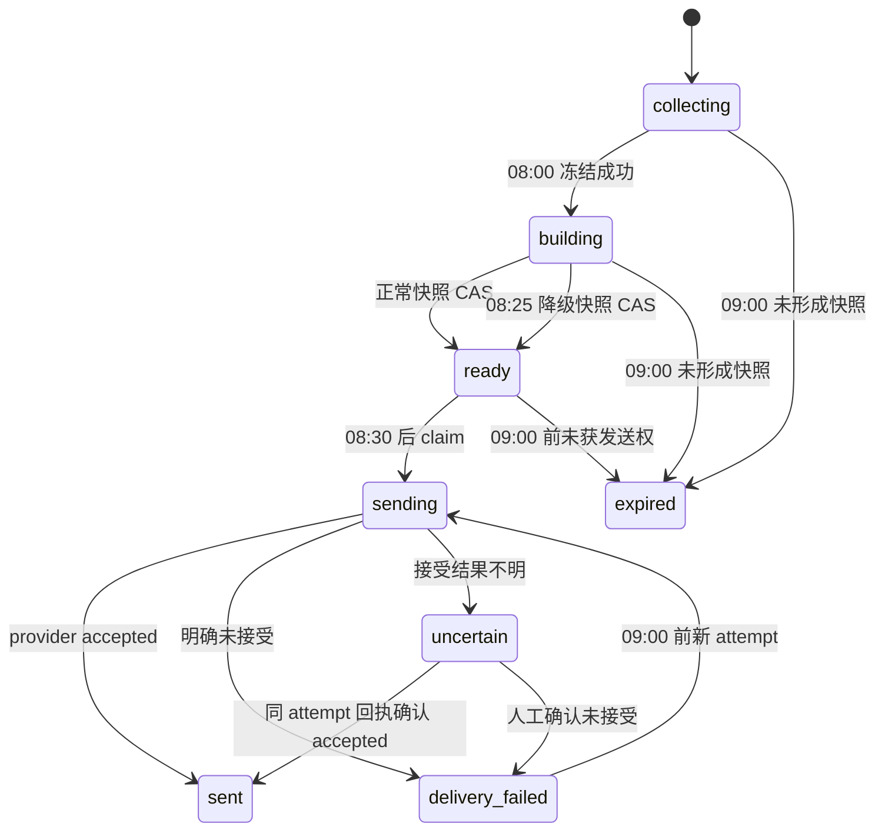

# 可靠性、幂等与故障恢复细则

本文细化 `docs/01-spec.md` 的可靠性行为，`docs/00-design.md` 仅作设计背景；若有冲突，以 `docs/01-spec.md`、`reference/contracts.ts` 和 `reference/schema.sql` 为准。D1 是业务状态的权威来源；Cloudflare Workflows 是可重放的执行器，不是跨 D1、Workflow API 和外部提供方的事务管理器。所有时间戳均为 UTC epoch milliseconds；面向用户的日期与时间只按 `Asia/Shanghai` 解释。v1 对其他时区配置返回配置错误，而不是静默套用固定偏移。

本文只使用既定表：`sources`、`source_leases`、`collection_pages`、`items`、`item_versions`、`events`、`event_versions`、`digests`、`digest_candidates`、`digest_events`、`deliveries`、`delivery_attempts`、`runs`、`request_keys`、`budget_buckets`、`llm_calls`。下文 SQL 使用最终 schema 的列名，省略处只表达概念步骤；列名、枚举和约束以 `reference/schema.sql` 与 `reference/contracts.ts` 为准。

## 1. 不变量与故障模型

实现必须保持以下不变量：

1. 同一计划任务有稳定业务键：小时采集为 `sourceId + scheduled UTC hour`，日报为 `profile + local date`。Cron 重复投递只能命中同一个键。
2. 调度器先在 `runs` 写入 `pending_create`，再调用 Workflow `create`。D1 提交与 Workflow 创建之间不宣称原子性；heartbeat 根据 `runs` 和 Workflow 实例状态补偿。
3. 同一来源最多一个有效租约持有者。每次接管递增 fencing token；旧持有者即使仍在运行，也不能提交分页 checkpoint 或倒退游标。
4. 08:00 冻结的是在 cutoff 前已经提交到 D1 的不可变版本集合。冻结后不再从 `items` 的当前正文或实时配置重新查询内容。
5. 同一日报只允许 `digests.build_generation` 指定的 generation 提交快照。恢复实例取得新 generation 后，旧实例必须被终止或在所有后续条件写入中失权。
6. 同一 delivery attempt 只有一次外部调用资格。`sent` 只表示提供方明确 accepted；无法判断是否 accepted 时是 `uncertain`，不得自动重发。
7. 模型调用先足额预留再调用。`calling` 后账单未知时保留最大预留；没有证据时不得通过“假定未计费”释放预算。
8. 预览永不发送，也不进入跨日 novelty 的“已报道”集合。`SEND_ENABLED=false`、dummy sender 或配置不完整时，生产 `sent` 不可达，suppressed 结果同样不消耗报道历史。

这些约束处理的故障包括：Cron 至少一次或漏投、Worker 在任意 `await` 前后终止、Workflow 步骤重试或整段重放、D1 写入失败、提供方超时和响应丢失，以及恢复流程与原流程并行。它们不承诺外部发送的严格 exactly-once，也不承诺未知模型供应商费用绝对封顶。

## 2. 计划槽、任务日期与 heartbeat

### 2.1 从计划时间派生身份

调度入口必须使用 `event.scheduledTime` 计算计划槽与业务日期；`Date.now()` 只用于判断“现在是否仍允许做这件事”。禁止用实际到达时间生成 run key，因为延迟投递和重复投递会因此变成不同任务。

| Cron | 计划槽身份 | `Asia/Shanghai` 行为 |
| --- | --- | --- |
| `0 * * * *` | `floor(event.scheduledTime / 1h)` 对应的 UTC 小时 | 为每个启用来源登记该小时的采集 run；到达晚也不改槽 |
| `45 23 * * *` | 由 `event.scheduledTime` 转为本地日期 | 本地 07:45 晨间补采并启动该日期日报；例如 UTC 9 月 20 日 23:45 属于本地 9 月 21 日 |
| `*/5 * * * *` | `floor(event.scheduledTime / 5m)` | heartbeat；补偿未创建的 run，并且只在本地 08:35、08:40、08:45、08:50、08:55 执行当日恢复动作 |

heartbeat 每次只扫描一个有界回看区间，至少覆盖最近一个已到期小时槽、当日 07:45 日报槽，以及仍在自动恢复窗口内的当日日报。它补登记完全缺失的 `runs`，也补偿已有 `pending_create` 但未能确认 Workflow 实例的记录。09:00 之后不得为当日启动新的生成或发送尝试；遗漏内容进入次日合并覆盖窗口。

Cron 可能重复：插入稳定业务键冲突时读取既有 run，不创建随机替代 run。Cron 也可能缺失：heartbeat 用“按 `scheduledTime` 应存在的槽”补建，不用当前时刻冒充原槽。非常晚才发现的小时采集不排队补齐无限历史，只补有界回看；日报不生成积压的逐日消息。

### 2.2 日报时间门

| 本地时间 | 允许动作 | 明确禁止 |
| --- | --- | --- |
| 07:45–07:59 | 晨间补采、等待已启动的采集 | 提前改变 08:00 cutoff |
| 08:00 | 原子冻结候选与版本引用；开始编辑 | 把 08:00 后提交的数据补进已冻结集合 |
| 08:00–08:24 | 正常筛选、归并、生成、校验 | 因某一来源未完成而无限等待 |
| 08:25 | 编辑截止；若正常快照未提交，以 CAS 递增 `build_generation` 后争抢降级快照提交权 | 旧正常分支稍后覆盖降级快照 |
| 08:30 | 对已提交快照争抢发送权 | 发送未冻结、未校验或 preview 内容 |
| 08:35–08:55 | 每 5 分钟对账并有界恢复 | 重发 `sent`、`uncertain` 或过期 `sending` |
| 09:00 起 | 标记当日自动窗口关闭，保留状态供查询与人工对账 | 新模型调用、新 delivery attempt、积压日刊自动发送 |

08:25 的降级接管先递增 `build_generation`，使仍在编辑的旧 generation 立即失去提交权，也 fence 掉尚在执行的旧 generation LLM 结果。降级路径不等待在途模型回执，也不再启动 LLM，只使用已冻结且由程序可验证的标题、来源、规范 URL、质量/覆盖信息，可以少于 5 条或明确报告采集异常。在途调用稍后有可信回执仍正常结算 `llm_calls`；没有输出且账单不明则保持 `uncertain` 并占用预留，但无论哪种结果都不能写入已被 fence 的日报快照。降级版不得为了凑条数扩大候选范围。若没有任何可验证候选，则保存“采集异常/暂无可用来源”的快照；“全部核心源失败”不得表述为“今天没有新闻”。

DailyDigestWorkflow 把同一 `local_date` 的 08:00、08:25、08:30 和 09:00 转成确定的 UTC epoch，再用确定性命名的 `step.sleepUntil` 等待；恢复时不得根据新的 `Date.now()` 重算日期。每次唤醒后仍以实际 `now` 检查门槛：晚于计划可以执行尚未过期的动作，达到 09:00 则只收敛状态，不开始新的外部调用。

## 3. run 登记、Workflow 创建与补偿

计划器执行以下协议：

1. 用稳定 `job_key` 向 `runs` 插入 `pending_create`，同时确定并保存稳定的 `workflow_id`。重复插入返回既有 run。
2. 提交成功后才调用相应 Workflow binding 的 `create({ id: workflowId, params })`。参数只含 run/digest/source 引用、计划槽、deadline 和 generation，不传大正文。
3. 创建明确成功后，把 run 标为“实例已观察到”；这只是观测信息，不能覆盖 Workflow 已经写入的更后阶段状态。
4. 创建调用抛错或超时，不立即生成新 ID。heartbeat 先用稳定 ID `get()` 并读取实例状态：存在即修复 `runs` 映射；明确不存在才用同一 ID再次创建。重复 ID 响应按“实例已存在”对账，不当作业务失败。
5. 若 D1 的首次 `pending_create` 写入失败，禁止创建 Workflow，因为后续没有权威 run 可供 fencing 和对账。

这里的窗口是可恢复的：

| 中断点 | 持久证据 | 补偿 |
| --- | --- | --- |
| `runs` 提交前 | 无 run | 重复调度重新尝试登记；无 Workflow 应被创建 |
| `runs` 已提交、`create` 前 | `pending_create` + 稳定 ID | heartbeat 查询实例；不存在则同 ID 创建 |
| `create` 已接受、客户端未收到响应 | `pending_create`；实例可能存在 | 先 `get/status`，禁止盲目换 ID |
| 实例存在、回写 run 前 | Workflow 有状态，run 仍 `pending_create` | heartbeat 把 run 推进到 `running`；不得 `restart` 既有实例 |
| Workflow 终态、run 状态滞后 | D1 业务表与实例终态 | 以业务表阶段为准对账，不能因 run 滞后重做副作用 |

Cloudflare 文档说明：`create` 对仍在保留期内的重复 ID 会报错；`createBatch` 对重复 ID会跳过。因此实现可以对小时来源批量使用 `createBatch`，但仍必须逐个对账其返回列表和 D1 run，不能把“未出现在返回列表”直接记成失败。参见 [Workers API](https://developers.cloudflare.com/workflows/build/workers-api/)。

## 4. Workflow 重放、generation 与 fencing

### 4.1 步骤缓存不是业务幂等

Workflows 成功完成的 `step.do` 会按确定性的步骤名缓存结果；实例重启时，`run()` 的步骤外代码可能再次执行。步骤名必须由固定阶段名和稳定序号组成，不能含 `Date.now()`、随机数、当前页数的非持久排序或实时配置值。分支只能依赖 event payload 或既有步骤的持久返回值。[Rules of Workflows](https://developers.cloudflare.com/workflows/build/rules-of-workflows/) 明确把步骤名视为缓存键，并要求副作用位于步骤内。

仍需注意：回调已产生外部副作用、但步骤成功结果尚未持久化时，回调可能重试；新的 recovery instance 也没有原实例的步骤缓存。因此每个步骤回调都必须先依赖 D1 唯一键/条件更新取得业务执行权。不要把“检查 `build_generation`”做成单独的早期步骤再长期信任其缓存结果；generation 条件必须和该步骤的业务写入或 claim 放在同一个 D1 条件操作中。

不得在 `step.do` 外执行随机、读当前时间决定分支、创建子 Workflow、调用模型或发送。发送步骤显式配置 retries 为 0，sender 的 HTTP 客户端也禁用自动重试。普通读取至多额外重试 2 次，schema repair 至多额外 1 次；每个 stage 的总 attempt 仍不得超过 3。永久 4xx 不重试，429 的 Retry-After 不得越过阶段 deadline。

### 4.2 来源租约

租约获取与续租是两个条件写入。acquire 仅在没有记录或现有租约已过期时成功，并在接管时递增 `fencing_token`；同一 owner 的未过期租约不能再次走 acquire。renew 仅在 `owner_id`、原 `fencing_token` 都匹配且租约仍未过期时延长 `expires_at`，不得递增 token。CollectSourceWorkflow 在每页持久化和最终游标提交时同时满足：

- 来源仍启用；
- `owner_id` 与当前 run/instance 一致；
- `fencing_token` 等于当前 token；
- `expires_at` 尚未过期；
- `sources.cursor_version` 等于预期版本。

租约过期不代表旧实例已停止。旧实例随后完成的网络请求可以丢弃；它不能提交 checkpoint 或游标。续租失败立即结束该实例，禁止“最后再写一次游标”；若仍需运行，只能重新 acquire 并取得更大的 token。同一实例内网络并发上限 2，不改变“同一来源一个有效租约”的规则。

### 4.3 日报 generation 接管

正常实例使用 generation 0。恢复需要新执行器时，以 D1 条件更新把 `digests.build_generation` 递增，并为新 `runs` 记录相同 generation、使用包含 generation 的唯一 Workflow ID。接管顺序为：

1. 读取 D1 阶段和 delivery/LLM attempt 状态；若已有外部调用处于 `calling`/`sending`，不创建竞争调用，先归类为 `uncertain` 或等待可证明的回执。
2. CAS 递增 `build_generation`；失败者退出。该 CAS 先于 terminate，立即阻止旧实例的新写入和发送；发送 claim 仍是独立的 delivery CAS。
3. 对旧 Workflow 调用 `terminate()` 作为尽力清理。终止失败不能撤销接管；D1 fencing 已让旧实例失去后续提交权。Cloudflare Workers API 提供实例 `terminate()`，见 [Workers API](https://developers.cloudflare.com/workflows/build/workers-api/)。
4. 新实例只从 D1 已提交阶段继续。它复用同一 digest、候选集合、版本引用和已提交正文，不重新建立业务日报。

旧实例可能在 generation 切换前已发出无法撤销的外部请求，所以接管不能把正在发送的 delivery 改回 pending。所有摘要快照提交、发送 claim 和终态写入都要带 `build_generation`/attempt 条件；旧实例的条件写入影响 0 行时必须停止。

## 5. 分页提交、游标与版本冻结

### 5.1 分页提交协议

`collection_pages` 以 `(run_id, page_no)` 保存分页 checkpoint 和 `request_cursor_json` / `next_cursor_json`。同一页内每个条目的 `item_versions.ingest_key` 由稳定的 run、页号和条目标识派生；`item_versions.collection_run_id/collection_page_no` 通过复合外键指向该 checkpoint。来源创建时就把 `sources.cursor_json` 初始化为 `{highWater, resume, scanStartedAt}` 对象，不能留为 SQL NULL。处理一页时：

1. 在租约有效时读取已提交 checkpoint 和 `sources.cursor_json`。该游标固定为 `{highWater, resume, scanStartedAt}`：有 `resume` 就从中断页继续，否则从 `highWater` 开始新扫描并设置 `scanStartedAt`。若 `(run_id,page_no)` 尚不存在，先以 fencing/cursor 守卫登记 `pending` checkpoint。
2. 抓取一页；先校验响应大小、解析上限和分页 token。按 D1 参数/语句上限把条目拆成小批，每批以相同 fencing 和 `cursor_version` 守卫写 `items` 及不可变 `item_versions`，页面保持 `pending`，`items.current_revision` 保持指向上一个 committed 版本。新 item 可暂时保持 `current_revision = 0`。
3. 所有小批成功后执行最终小型 D1 batch：把本页涉及 item 的 `current_revision` 切到本页选定 revision，把页面改为 `committed` 并写 DB `committed_at`，同时推进 `sources.cursor_json.resume` 和 `cursor_version`。三类写入使用同一 owner/token/expiry/expected cursor 守卫。
4. 若适配器确认本轮全扫描完成，最终 batch 才把新的安全边界写入 `highWater`、清空 `resume` 和 `scanStartedAt`；若仍有下一页，只推进 `resume`。命中每轮 3 页上限时保留 `resume`，不得把中间位置提升为 `highWater`。
5. 检查每个条件写入的影响行数。租约或游标版本不匹配视为失权，不得继续下一页。任一暂存小批或最终 batch 失败时，页面继续为 `pending`，暂存版本对冻结查询不可见，`current_revision` 与安全高水位不变。
6. 步骤结果只返回小型 checkpoint 引用。崩溃重放先查 `collection_pages`；已提交页直接跳过，pending 页依靠 `ingest_key` 重放。新 owner 不得把孤立 pending 版本当成当前版本或内容去重依据。

D1 `batch()` 中的语句顺序执行，任一语句失败会中止或回滚整个序列，见 [D1 batch](https://developers.cloudflare.com/d1/worker-api/d1-database/#batch)。但“条件不满足、影响 0 行”通常不是 SQL 错误，因此所有会产生副作用的语句本身都必须带相同 fencing 条件，且调用方必须验证 changes；不能指望最后一条 CAS 自动回滚前面的无条件 INSERT。

远端请求成功但 D1 暂存或最终 batch 失败时不推进安全游标；重试可重复抓取。最终 batch 成功但 Worker 在收到结果前终止时，`item_versions.ingest_key`、`current_revision` 和 committed checkpoint 使重放成为 no-op。`content_hash` 不做条目全历史唯一键：若 committed 历史为 A→B→A，第三次 A 仍追加新 revision；只有抓取内容与 `current_revision` 指向的**已提交版本**相同才跳过，孤立 pending 版本不能阻止重新入库。

分页上限为每源 3 页、每页 30 条；到达上限且仍有 next cursor 时保存可继续 checkpoint，后续计划槽从安全位置继续。不得为赶 08:00 而把未完整提交页的 cursor 提前写入。

### 5.2 08:00 冻结

冻结由唯一赢家执行一次 D1 条件 batch：创建/确认当日 digest，将 `item_versions` 按 `(collection_run_id, collection_page_no)` join `collection_pages(run_id, page_no)`，只从同时满足 `item_versions.ingested_at <= digests.cutoff_at`、页面 `status = 'committed'` 且 `committed_at <= digests.cutoff_at` 的版本中，为每个 item 选择截止前最新 revision，并把 `item_id/item_version_id` 写入 `digest_candidates`。同时在 `digests` 保存 cutoff、覆盖区间和 `config_snapshot_json`。`ingested_at` 和 `committed_at` 必须取 D1 写入时钟，不能用请求开始时间倒填；`published_at` 只用于展示和编辑规则，不能替代入库或整页提交时间。事件版本在后续编辑成功时写入 `digest_events`。

冻结提交后：

- 编辑只读 `digest_candidates` 和其中的版本引用；不得 join 回可变“当前正文”来替换版本。
- 08:00 后提交的迟到条目进入下一份日报的 72 小时补充窗口。
- `digest_events` 保存最终采用的 `event_version` 和当时证据快照；后续来源更新不能改变历史日报。
- Workflow 恢复、08:25 降级与 08:35 后恢复全部复用同一冻结集合。
- 冻结 batch 未提交则仍为未冻结；heartbeat 可以重试同一条件 batch。只提交一半不是合法状态。

## 6. 日报与恢复状态机



状态只能按表中条件推进；实现可使用 `DigestStatus` 已定义的枚举，不得增加“看起来成功”的旁路状态。

| 当前状态 | 事件与守卫 | 下一状态 | 副作用 |
| --- | --- | --- | --- |
| `collecting` | 08:00，冻结 CAS 成功 | `building` | 固定候选和版本引用 |
| `building` | 08:25 前正常快照校验通过，且 `build_generation` 匹配 | `ready` | 提交不可变正文/内容哈希 |
| `building` | 08:25 后无快照，`build_generation + 1` CAS 胜出 | `ready` | 提交确定性链接版；旧正常分支从此失权 |
| `ready` | ≥08:30、<09:00、发送配置有效，delivery claim 胜出 | `sending` | 新建 attempt，随后外部调用 |
| `ready` | 发送关闭、preview、dummy 或配置无效 | `ready`；09:00 后为 `expired` | delivery 记 `suppressed`；不调用渠道、不消耗报道历史 |
| `sending` | 明确 accepted，attempt CAS 胜出 | `sent` | 保存 `provider_message_id/accepted_at`；仅真实 scheduled delivery 进入报道历史 |
| `sending` | 明确未 accepted 且策略允许 | `delivery_failed` | 记录可重试失败 |
| `sending` | 超时/断连/无法证明未接受的 5xx | `uncertain` | 禁止自动重试；等待人工回执对账 |
| `delivery_failed` | heartbeat，<09:00，仍允许且新 claim 胜出 | `sending` | 新 attempt；复用同一正文 |
| `uncertain` | 原 attempt 的延迟回执或人工查询确认 accepted；可在 09:00 后 | `sent` | 按同一 attemptId CAS 补记并审计；不再次 send |
| `uncertain` | 运维人员从提供方确认未接受 | `delivery_failed` | 人工维护并审计；09:00 后仍不得自动补发 |
| `collecting` / `building` / 未发送的 `ready` | now ≥09:00 | `expired` | 关闭当日自动窗口；次日合并缺口 |

08:35–08:55 heartbeat 的处理顺序固定：先核对 D1 已有回执，再核对 Workflow 状态，再决定原实例继续、接管 generation、提交降级版或对明确失败创建新发送 attempt。v1 heartbeat 不替运维人员查询提供方的 `uncertain` 回执。处于正常运行且仍可能安全完成的实例不启动竞争 generation；已经 `sent` 或 `uncertain` 的日报直接跳过。

## 7. 发送边界与 `uncertain`

发送协议按 delivery 粒度执行：

1. 预先存在 `pending` delivery。发送者在一个 D1 batch 内用条件 UPDATE 把 `pending` 或明确可重试的 `failed` 变为 `sending`、关联新的 attemptId，以该 attemptId 插入 `delivery_attempts.calling`，并把对应 digest 从 `ready` 或 `delivery_failed` 改为 `sending`。只有 delivery 和 digest 各影响 1 行且 attempt 插入成功者继续。batch 结果不明时先查这些记录，不能直接 send。
2. 只有上述 `calling` 已持久化后才能发外部 `fetch`。即使 Worker 恰好在落库后、发请求前终止，恢复也保守视为结果不明，避免错误重发。
3. sender 只发固定配置的 channel/destination，使用 digest 内容哈希派生的稳定提供方幂等键（仅当该提供方明确支持）。幂等键不改变 v1 的 uncertain 策略。HTTP 层不自动重试，Workflow 发送步骤 retries 为 0。
4. 提供方明确 accepted 后，按 attemptId CAS 把 attempt/delivery/digest 写为成功终态并保存回执。该 CAS 允许 delivery/digest 从 `sending` 或 `uncertain` 转为 `sent`，但 attemptId 必须仍是原调用；这样 09:00 后到达的延迟 accepted 只能补记原结果，不能覆盖新 attempt。若写入响应丢失，后续只能根据已保存回执或人工提供方查询修复，不能再次 send。
5. 提供方明确拒绝且能证明未接受，把 attempt/delivery 写为 `failed`，digest 写为 `delivery_failed`。只有这种失败可在 09:00 前由 heartbeat 新建 attempt；每个 delivery 最多 3 个 attempt。
6. 请求超时、连接在提交后断开、响应不可解析，或 5xx 无法证明未接受时，把 attempt、delivery 和 digest 写为 `uncertain`。过期 `sending` 也转为 `uncertain`，不转回 `pending`。

D1 claim 能保证数据库内只有一个赢家，却不能把 D1 状态改变和外部提供方接受合成一个事务。严格 exactly-once 只可能由提供方幂等键/回执查询共同缩小边界；本系统的承诺是：**明确成功不重发，结果不明不自动重发，明确未接受才有界重试**。`uncertain` 即使带提供方幂等键也永不自动重放。原 attempt 的延迟 accepted 可以按同一 attemptId CAS 补记 `sent`；除此以外，v1 只允许运维人员查询回执：确认 accepted 后人工补记 `sent`，提供方契约能明确证明未接受时人工修复为 `failed/delivery_failed`。两种人工维护都不产生 send，且不提供公开“强制发送”接口。09:00 只关闭新外部调用；09:00 前已经 accepted、但回执落库延迟的结果仍可补记 `sent`。

人工对账把审计事件 append 到原 `delivery_attempts.response_summary_json.audit` 数组，元素固定为 `{at, operator, action, evidenceRef, priorState, newState}`；同一 JSON 对象中的 provider summary 保持不变。首次写响应摘要时确保 `audit: []` 存在，旧值缺少该键时先补空数组再 append。维护 CLI 必须记录 actor 与操作类型；`evidenceRef` 只放工单号、提供方回执 ID 或脱敏日志引用，audit 数组和 CLI 日志都不得写 token、邮箱地址、完整消息正文或其他密钥。审计 append、attempt/delivery/digest 状态 CAS 必须在同一 D1 batch 中提交。

`sent` 表示 provider accepted，不保证送达收件箱。跨日 novelty 的“已报道”集合只读取真实 scheduled delivery 的 `sent` 或 `uncertain` 日报；preview、dummy、`SEND_ENABLED=false` 和其他 `suppressed` delivery 均排除。dummy sender、`SEND_ENABLED=false` 和 preview 只能创建 `suppressed` delivery 或不创建 delivery，绝不能伪造生产 `sent`。D1 Time Travel 恢复前暂停 Cron 发送；恢复后逐条核对恢复点之后可能已被外部接受的 delivery，在对账完成前保持 `uncertain` 或 `suppressed`。

## 8. 模型预算预留与未知账单

预算单位为 USD microdollar 整数，账期严格使用 UTC day/month。每次真实模型调用遵循：

1. 根据模型价格配置、最大输入和最大输出计算最坏费用。价格或能力配置缺失时禁止调用，并走降级内容。
2. 先构造稳定 `invocationId`，绑定 digest、generation、原始 owner stage、稳定 batch 序号和 prompt version；`attemptNo` 为 1–3，repair 沿用 owner stage 的总计数。`callId = SHA256(invocationId + attemptNo)`。Workflow 重放复用同一 call/attempt，只有业务明确决定重试才递增 attemptNo。
3. 计算 `reservation = max(1, estimatedCostMicrousd)`，在一个 D1 batch 内同时检查日桶与月桶余额，并为同一 llm attempt 预留该金额；任一桶不足则整批失败。即使真实免费调用估价为 0，也用 1 microUSD 建账，成功后可按实际 0 结算。并发调用不能分别读余额后再无条件扣款。
4. `llm_calls` 同时持久化 `invocation_id`、`generation`、`deadline_at` 和 attemptNo。写入 `reserved` 后，在 CAS 为 `calling` 前重新校验当前 digest generation 和实际 now 未越过 deadline。本地校验失败、deadline 已过等可证明“请求从未发出”的 attempt 可以释放预留。
5. 响应带可信 usage 时，把调用记为 `succeeded`，`actual_microusd` 记录实际费用。有通过 schema 校验的有效输出但 usage 缺失时同样记为 `succeeded`，但 `actual_microusd = reserved_microusd`，并在 `usage_json` 标记 usage unknown；这会把最大预留保守转为已花费，而不是留下一个悬空预留。
6. `calling` 后崩溃、超时、响应丢失，且没有可用输出、供应商账单语义也不明时，attempt 为 `uncertain`，最大预留不自动返还。永久 4xx 也只有在提供方契约或明确响应证明未执行推理时才可释放。
7. 重试使用同一 invocation 的新 attemptNo/callId，并重新做完整预留；旧 `calling`/`uncertain` 预留继续占用额度。预算不足则降级，不借用未来日/月额度。

`llm_calls` 是费用事实账本。每次状态变化后，日/月 `budget_buckets.spent_microusd` 与 `reserved_microusd` 都从相关调用记录重新聚合，而不是对旧桶值盲目加减：`succeeded` 以及已明确结算的 `failed` 调用按 `actual_microusd` 计入 spent，`reserved/calling/uncertain` 按 `reserved_microusd` 计入 reserved；只有已证明请求未发出或未受理、且 `actual_microusd = 0` 的 failed 调用不占额度。由此重复结算不会重复扣费。有输出但 usage unknown 的 succeeded 已按最大值计入 spent。若可信实际费用超过预留，仍记录真实费用并停止后续 LLM 调用，不得裁剪账本掩盖超额。只有成功且 schema 校验通过的结果能按 `cache_key = SHA256(canonical input + stage + model + baseUrl 标识 + promptVersion + 能力配置子提示)` 复用；超时或不确定调用不得被缓存成可复用成功。

该方法在配置价格正确、供应商按可观测 token/请求计价时提供应用内硬门。供应商隐藏费用、异步工具费或错误价格配置仍可能让真实账单超过账本，因此状态页必须分别展示“已结算”和“保守占用”，不得宣称未知供应商费用绝对封顶。

## 9. 概念伪 SQL

以下片段使用 `reference/schema.sql` 已定义的列名，但省略业务值构造和逐条 item 展开，因此是协议示意而非可直接执行的迁移。

```sql
-- A. 先登记 run；job_key 和 workflow_id 都有唯一约束。
INSERT INTO runs (
  id, job_key, workflow_id, kind, state, source_id, digest_id, generation,
  scheduled_at, deadline_at, params_json, created_at, updated_at
)
VALUES (
  :run_id, :job_key, :workflow_id, :kind, 'pending_create', :source_id,
  :digest_id, :generation, :scheduled_at, :deadline_at, :params_json, :now, :now
)
ON CONFLICT (job_key) DO NOTHING;

-- Workflow create 发生在此 D1 提交之后；失败由 heartbeat 按 workflow_id 对账。
```

```sql
-- B1. acquire：仅无记录或已过期时成功；接管才递增 fencing_token。
INSERT INTO source_leases (source_id, owner_id, fencing_token, expires_at)
VALUES (:source_id, :run_id, 1, :lease_deadline)
ON CONFLICT (source_id) DO UPDATE SET
  owner_id = excluded.owner_id,
  fencing_token = source_leases.fencing_token + 1,
  expires_at = excluded.expires_at
WHERE source_leases.expires_at <= :now
RETURNING fencing_token;
-- 必须恰好返回一行；0 行表示没有租约。

-- B2. renew：同一未过期租约只延长时间，不改变 token。
UPDATE source_leases
SET expires_at = :lease_deadline
WHERE source_id = :source_id
  AND owner_id = :run_id
  AND fencing_token = :token
  AND expires_at > :now
RETURNING fencing_token;
-- 0 行表示租约已经失效；调用者停止，不能退回 acquire 后继续旧操作。
```

```sql
-- C. item/item_version 可分小批暂存，collection_pages 保持 pending，
-- current_revision 不动。最终 batch 的每条 UPDATE 都重复以下
-- owner/token/expiry/cursor_version 守卫。
-- item_versions 的 ingest_key 按 run_id + page_no + item 派生；只有与
-- items.current_revision 指向版本的 content_hash 不同才插入 revision+1；
-- collection_run_id/collection_page_no 写当前 run_id/page_no，并由复合 FK
-- 指向本页 collection_pages checkpoint。

UPDATE items
SET current_revision = (
  SELECT MAX(v.revision)
  FROM item_versions v
  WHERE v.item_id = items.id
    AND v.collection_run_id = :run_id
    AND v.collection_page_no = :page_no
)
WHERE EXISTS (
    SELECT 1 FROM item_versions v
    WHERE v.item_id = items.id
      AND v.collection_run_id = :run_id
      AND v.collection_page_no = :page_no
  )
  AND EXISTS (
    SELECT 1
    FROM source_leases l JOIN sources s ON s.id = l.source_id
    WHERE l.source_id = :source_id
      AND l.owner_id = :run_id
      AND l.fencing_token = :token
      AND l.expires_at > :now
      AND s.cursor_version = :expected_cursor_version
  );

UPDATE collection_pages
SET status = 'committed', item_count = :item_count,
    next_cursor_json = :next_cursor_json, committed_at = :now, error_code = NULL
WHERE run_id = :run_id
  AND page_no = :page_no
  AND status = 'pending'
  AND EXISTS (
    SELECT 1
    FROM source_leases l JOIN sources s ON s.id = l.source_id
    WHERE l.source_id = :source_id
      AND l.owner_id = :run_id
      AND l.fencing_token = :token
      AND l.expires_at > :now
      AND s.cursor_version = :expected_cursor_version
  );

UPDATE sources
SET cursor_json = CASE
      WHEN :scan_complete = 1 THEN json_set(
        cursor_json,
        '$.highWater', json(:new_high_water_json),
        '$.resume', json('null'),
        '$.scanStartedAt', json('null')
      )
      ELSE json_set(cursor_json, '$.resume', json(:next_resume_json))
    END,
    cursor_version = cursor_version + 1,
    last_success_at = :now,
    updated_at = :now
WHERE id = :source_id
  AND cursor_version = :expected_cursor_version
  AND EXISTS (
    SELECT 1 FROM source_leases
    WHERE source_id = :source_id
      AND owner_id = :run_id
      AND fencing_token = :token
      AND expires_at > :now
  );
-- 条件影响 0 行不会触发 SQL 错误；调用方检查最终三类写入的预期 changes。
-- scan_complete=0（包括第3页仍有next）只推进resume；只有完整扫描才推进
-- highWater并清resume/scanStartedAt。不得在暂存小批修改current_revision或cursor。
```

```sql
-- D. 发送 claim；目标、正文和 attempt 均由已有记录决定，调用者不能注入。
UPDATE deliveries
SET status = 'sending', attempt_id = :attempt_id,
    attempt_count = attempt_count + 1, claimed_at = :now, updated_at = :now
WHERE id = :delivery_id
  AND attempt_count < 3
  AND (status = 'pending'
       OR (status = 'failed' AND retryable = 1 AND next_attempt_at <= :now))
  AND EXISTS (
    SELECT 1 FROM digests
    WHERE id = deliveries.digest_id
      AND mode = 'scheduled'
      AND status IN ('ready', 'delivery_failed')
      AND build_generation = :generation
      AND :now >= send_at
      AND :now < send_deadline_at
  );

INSERT INTO delivery_attempts (id, delivery_id, state, started_at)
SELECT :attempt_id, id, 'calling', :now
FROM deliveries
WHERE id = :delivery_id
  AND status = 'sending'
  AND attempt_id = :attempt_id;

UPDATE digests
SET status = 'sending', updated_at = :now
WHERE id = (SELECT digest_id FROM deliveries WHERE id = :delivery_id)
  AND status IN ('ready', 'delivery_failed')
  AND build_generation = :generation
  AND EXISTS (
    SELECT 1 FROM deliveries
    WHERE id = :delivery_id
      AND status = 'sending'
      AND attempt_id = :attempt_id
  );
-- 上述三条在同一 batch；delivery/digest changes 都为1且 attempt insert 成功的
-- 唯一赢家才能调用 sender。第一条已在同一事务快照中验证 digest 的旧状态，
-- 后续 digest 更新因此必须命中；调用方仍检查每条 changes。
-- SEND_ENABLED 和 destination 配置也必须在 claim 前通过检查。

-- accepted 终态同样在一个 batch 内按原 attemptId CAS。
UPDATE deliveries
SET status = 'sent', provider_message_id = :provider_message_id,
    accepted_at = :accepted_at, updated_at = :now
WHERE id = :delivery_id
  AND status IN ('sending', 'uncertain')
  AND attempt_id = :attempt_id;

UPDATE delivery_attempts
SET state = 'succeeded', finished_at = :accepted_at,
    provider_message_id = :provider_message_id
WHERE id = :attempt_id
  AND delivery_id = :delivery_id
  AND state IN ('calling', 'uncertain');

UPDATE digests
SET status = 'sent', accepted_at = :accepted_at, updated_at = :now
WHERE id = (SELECT digest_id FROM deliveries WHERE id = :delivery_id)
  AND status IN ('sending', 'uncertain')
  AND EXISTS (
    SELECT 1 FROM deliveries
    WHERE id = :delivery_id
      AND status = 'sent'
      AND attempt_id = :attempt_id
  );
```

```sql
-- D2. 人工对账：保留 response_summary_json 中的 provider summary，向其
-- audit 数组 append；审计与状态维护在同一 batch。旧对象无 audit 时先补 []。
UPDATE delivery_attempts
SET response_summary_json = json_set(
      COALESCE(response_summary_json, '{}'),
      '$.audit',
      json(COALESCE(json_extract(response_summary_json, '$.audit'), '[]'))
    )
WHERE id = :attempt_id
  AND state = :prior_state;

UPDATE delivery_attempts
SET response_summary_json = json_insert(
      response_summary_json,
      '$.audit[#]',
      json_object(
        'at', :at,
        'operator', :operator,
        'action', :action,
        'evidenceRef', :evidence_ref,
        'priorState', :prior_state,
        'newState', :new_state
      )
    )
WHERE id = :attempt_id
  AND state = :prior_state;
-- operator/evidence_ref 已脱敏；CLI 另记 actor 与操作类型，不记录密钥或正文。
```

```sql
-- E. 日/月预算预留必须在一个 D1 batch 中共同成功。
-- :reservation = max(1, :estimated_cost_microusd)；:call_id 是
-- SHA256(:invocation_id + :attempt_no)。先写权威调用事实；
-- 任一桶余额不足时写 0，触发 reserved_microusd > 0 CHECK，整批回滚。
-- 这里不能用 ON CONFLICT DO NOTHING：call id 或(invocation_id,attempt_no)
-- 冲突都应整批回滚后读取旧记录。
INSERT INTO budget_buckets (
  bucket_key, limit_microusd, reserved_microusd, spent_microusd, updated_at
)
VALUES
  (:day_bucket, :day_limit, 0, 0, :now),
  (:month_bucket, :month_limit, 0, 0, :now)
ON CONFLICT (bucket_key) DO NOTHING;

INSERT INTO llm_calls (
  id, cache_key, invocation_id, generation, deadline_at, attempt_no,
  digest_id, stage, model, prompt_version, state, day_bucket, month_bucket,
  reserved_microusd, created_at, updated_at
)
SELECT
  :call_id, :cache_key, :invocation_id, :generation, :deadline_at, :attempt_no,
  :digest_id, :stage, :model, :prompt_version, 'reserved',
  :day_bucket, :month_bucket,
  CASE WHEN
    (SELECT spent_microusd + reserved_microusd + :reservation <= limit_microusd
       FROM budget_buckets WHERE bucket_key = :day_bucket)
    AND
    (SELECT spent_microusd + reserved_microusd + :reservation <= limit_microusd
       FROM budget_buckets WHERE bucket_key = :month_bucket)
  THEN :reservation ELSE 0 END,
  :now, :now;

UPDATE budget_buckets
SET reserved_microusd = reserved_microusd + :reservation, updated_at = :now
WHERE bucket_key IN (:day_bucket, :month_bucket);

-- 结算不对旧值做增量修补；对 day_bucket/month_bucket 从 llm_calls 重算。
UPDATE budget_buckets
SET spent_microusd = (
      SELECT COALESCE(SUM(actual_microusd), 0)
      FROM llm_calls
      WHERE (day_bucket = budget_buckets.bucket_key
             OR month_bucket = budget_buckets.bucket_key)
        AND state IN ('succeeded', 'failed')
        AND actual_microusd IS NOT NULL
    ),
    reserved_microusd = (
      SELECT COALESCE(SUM(reserved_microusd), 0)
      FROM llm_calls
      WHERE (day_bucket = budget_buckets.bucket_key
             OR month_bucket = budget_buckets.bucket_key)
        AND state IN ('reserved', 'calling', 'uncertain')
    ),
    updated_at = :now
WHERE bucket_key IN (:day_bucket, :month_bucket);
-- 重复执行同一重算得到相同结果。
```

## 10. 失败矩阵

| 故障 | 检测证据 | 自动动作 | 发送规则 / 最终边界 |
| --- | --- | --- | --- |
| 同一 Cron 重复到达 | `runs` 稳定业务键冲突 | 返回既有 run；对账稳定 Workflow ID | 不新增日报或发送 |
| Cron 漏掉小时/07:45 | heartbeat 发现应有槽无 run | 在有界回看内按原计划槽登记并创建 | 不产生积压逐日邮件 |
| D1 run 登记失败 | 无 committed run | 重试登记；不 create Workflow | 无发送资格 |
| run 已登记，Workflow create 明确失败 | `pending_create` run；get 明确不存在 | heartbeat 同 ID 再建 | 保持单一业务 run |
| create 响应丢失 | `pending_create` run；实例存在性未知 | 先 get/status；存在则修复映射 | 禁止随机新 ID 或 restart |
| Workflow 步骤成功后实例重启 | 同名步骤已有缓存结果 | 复用步骤结果；后续仍查 D1 守卫 | 缓存不替代 delivery claim |
| 步骤副作用后、结果持久化前中断 | D1 可能已有唯一键/checkpoint | 重试回调，以 D1 幂等/CAS 判定 no-op | 外部调用结果未知按 uncertain |
| 同 owner 在租约未过期时续租 | owner/token/expiry 均匹配 | 只延长 `expires_at`，token 不变 | 既有 in-flight 页仍可用同 token 提交 |
| 来源租约到期后旧实例返回 | `fencing_token/owner_id` 不匹配 | 所有提交影响 0 行，旧实例退出 | 新 owner 可从已提交 checkpoint 继续 |
| 分页第 N 页抓取或解析失败 | 前 N-1 页 checkpoint；N 无 checkpoint | 保留已提交页，不推进 N 的 cursor；有界重试 | 日报记录覆盖缺口 |
| D1 page batch 响应丢失 | ingest key/checkpoint 可能存在 | 重查 checkpoint；存在则跳过，否则重放 | 不丢页、不双增 revision |
| 版本已写但页面在 cutoff 后才 committed | `committed_at > cutoff_at` | 当日冻结 join 排除，次日重新评估 | 不把半提交页带入当日 |
| 08:00 冻结失败 | 无完整 digest_candidates 冻结标记 | 同一候选条件 batch 重试 | 未冻结内容不能发送 |
| 部分源未完成 | 冻结时覆盖记录 | 按时冻结已提交版本，标注缺口 | 不无限等待 |
| 全部核心源失败 | 源运行状态/候选为空 | 08:25 生成明确异常降级版 | 不声称“无新闻” |
| 模型 429/暂时失败 | attempt 与 Retry-After | 在 08:25 前有界重试；否则降级 | 不为赶发送越过预算/截止 |
| 模型请求超时或 Worker 崩溃 | attempt 已 calling，无可信 usage | 保留最大预留；新重试重新预留 | 预算不足则降级 |
| 模型成功、有有效输出但无 usage | schema 校验通过，usage null | `succeeded.actual_microusd=reserved_microusd` 并标 usage unknown | 最大费用进入 spent，不释放差额 |
| 08:25 正常编辑未完成，LLM 仍在途 | digest 仍 building、无快照 | CAS `build_generation+1` 后立即走无 LLM 降级，不等回执 | 晚到输出不能覆盖；费用仍按回执或 unknown 结算 |
| 原实例在恢复时仍运行 | Workflow 状态 + `build_generation` | 能安全继续则不竞争；需接管则 generation++ 并尽力 terminate | 旧 generation 失去提交/claim 权 |
| 08:30 无 ready 快照 | digest 状态未 ready | 08:35–08:55 heartbeat 恢复或使用已提交降级版 | 09:00 后不自动发送 |
| 发送前 claim 竞争 | delivery 条件更新 changes | 只有 changes=1 者调用 sender | 数据库内单赢家 |
| 提供方明确拒绝且未接受 | 明确错误契约/响应 | 记 failed；09:00 前、总 attempt <3 时可新建 | 复用相同快照 |
| 提供方 accepted | accepted 响应/可验证回执 | 同一 attemptId 把 attempt/delivery/digest CAS sent | 可从 sending 或 uncertain 补记；正常重跑跳过 |
| 发送超时、断连、模糊 5xx | 无法证明未接受 | 记 uncertain；等待人工查回执 | 即使有幂等键也不自动重发 |
| `sending` 长时间无终态 | attempt 曾 calling | 转 uncertain，不转 pending | 不自动重发 |
| 09:00 后收到/查明此前已 accepted | 原 attempt 的 provider 回执 | 同 attemptId 补记 sent；人工维护时 append 审计数组 | 只修状态，不产生新 send |
| 人工判定 uncertain 未接受 | 脱敏 `evidenceRef` | attempt 审计数组与 failed/delivery_failed CAS 同批提交 | CLI 记 actor/操作，不记密钥或正文 |
| 09:00 仍未完成 | 本地 now 已达关闭时间 | 记 expired/关闭窗口，次日合并缺口 | 禁止当日新发送 attempt |
| D1 Time Travel 恢复 | 恢复点可能早于外部 accepted | 暂停发送并逐项对账 | 未核清一律 uncertain/suppressed |
| `SEND_ENABLED=false` / dummy / preview | 配置和 digest mode | 记录 suppressed 或预览结果 | 生产 sent 不可达，也不消耗报道历史 |

## 11. 实施验收

最少用故障注入验证以下行为：

- 同一小时与 07:45 事件各重复投递三次，只有一个业务 run 和稳定 Workflow ID。
- 在 run 提交后、create 前，以及 create 接受后、响应前分别中断；heartbeat 均恢复到一个实例。
- 采集实例 A 租约过期、B 接管后，让 A 的 fetch 最后返回；A 不能写 checkpoint 或倒退 cursor。
- 同一 owner 在未过期时连续 renew；`expires_at` 延长而 `fencing_token` 不变，过期后 renew 失败。
- 在一页 D1 batch 提交前后分别中断；最终条目、revision 和 checkpoint 与单次执行一致，并覆盖 A→B→A 版本序列。
- 让 item version 在 07:59:59 写入、页面在 08:00:01 才 committed；当天冻结必须排除它。
- 08:00 后写入一条发布时间更早的文章；它不进入当天冻结集合，次日按迟到规则可见。
- LLM 调用跨过 08:25；新 generation 不等回执即提交无 LLM 降级快照，晚到输出不能覆盖，调用费用仍正确结算。
- 恢复 generation 接管时让旧实例继续运行；旧实例的快照提交与 delivery 条件写入全部失败。
- 明确发送失败后重试 claim；delivery 从 failed、digest 从 delivery_failed 在同一 batch 进入 sending，只有一个 attempt 调用 sender。
- sender 在提供方接受后丢失响应；状态为 uncertain，所有 heartbeat 都不产生第二次 send。
- 对上述 uncertain 在 09:00 后收到或人工确认原 attempt 已 accepted；同 attemptId 补记 sent，不产生第二次 send。
- 人工把 uncertain 修复为 sent/failed 时，`response_summary_json` 追加完整六字段审计事件，CLI 日志没有密钥、地址或正文。
- 模型在 `calling` 后超时；日/月预留不释放，下一 attempt 重新预留，额度不足时降级。
- 模型返回有效输出但没有 usage；结果为 succeeded，实际费用按预留上限进入 spent，重复结算桶值不变。
- 把 heartbeat 分别放在 08:35、08:55、09:00；前两者只做允许的有界恢复，09:00 不创建新模型或发送 attempt。

## 12. 已统一的设计决策及保守默认

相较原始方案版本，交付包现已统一为 `*/5 * * * *` heartbeat，并在程序内把日报恢复限制为本地 08:35–08:55；条目版本也统一为 revision 递增和“仅与 `current_revision` 指向的 committed 版本相同才跳过”，从而保留 A→B→A 历史。实现不得恢复为每日单次恢复 Cron 或 `(item_id, content_hash)` 全历史唯一约束。

以下能力因渠道或平台契约不同采用保守默认，无需扩大架构：Workflow create 响应不明时先按稳定 ID 查询；旧实例先用 D1 generation 失权、平台 terminate 只作尽力清理；渠道幂等能力未明确时把发送结果不明记为 `uncertain`；模型没有输出且 usage/计费不明时保留最大预留，有有效输出但 usage 不明时按最大预留结算为 spent。具体渠道确定后只能收紧这些风险，不能把默认改成盲目重试或释放未知费用。
